<div align="center">

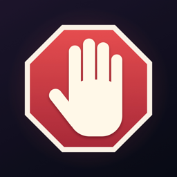

# NoBet

**A calm, private iPhone companion for quitting gambling.**

Track your streak and money saved, get through urges in real time, and build layers of protection against online casinos, all without your data leaving the phone.


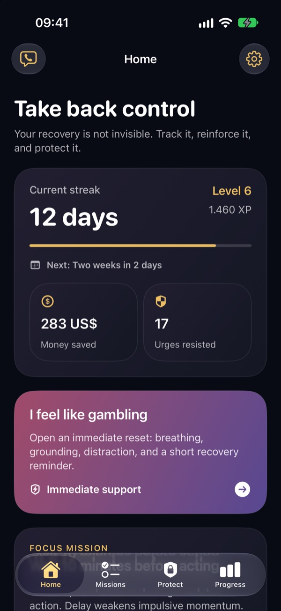&nbsp;&nbsp;
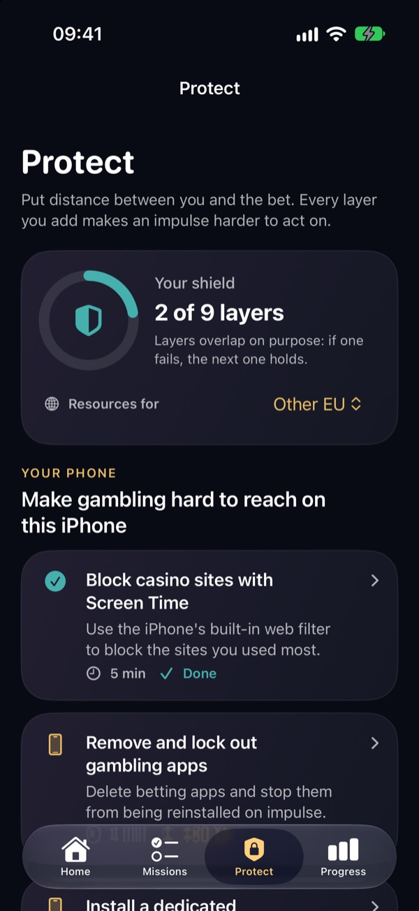&nbsp;&nbsp;
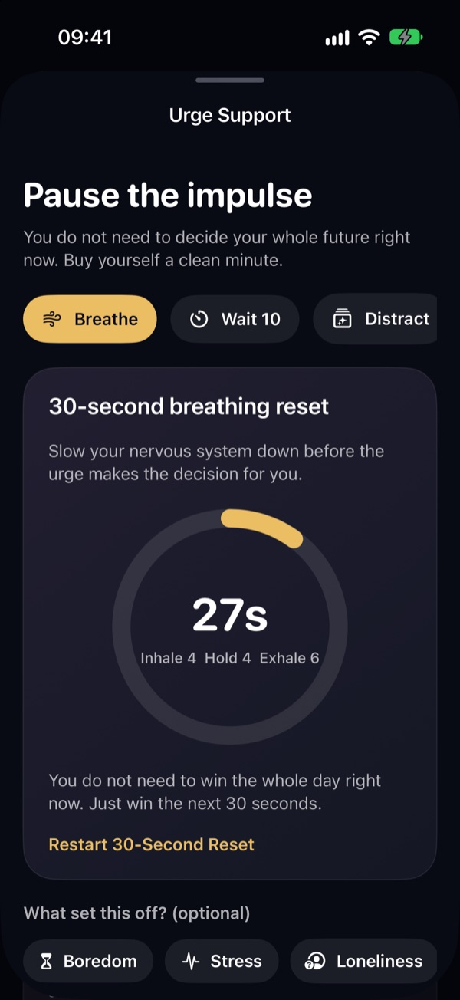

</div>

> [!NOTE]
> **The source code of this project is private.** This repository is its public showcase: the
> README, screenshots and every source file with its types and function signatures, but none of the
> code inside them. If you'd like a demo or to talk about the project, open an issue.

---

## Why NoBet

Most recovery apps stop at a streak counter. Most blocker apps stop at a block list. NoBet combines both and adds what people need in the ten minutes when an urge is strongest:

- **Interrupt the urge.** One button opens breathing, a 10-minute "ride the wave" timer, grounding, your own reasons for quitting, and a one-tap call to your trusted person.
- **Make gambling harder to reach.** A guided checklist walks you through nine protection layers, from Screen Time and blocker apps to your bank's gambling block and national self-exclusion.
- **Learn your patterns.** An urge journal shows which triggers (payday, stress, sports ads...) come up most, so you can plan around them.
- **No shame mechanics.** A slip restarts the streak but keeps every clean day you have earned. Rewards are fixed and predictable, with no loot boxes, chance, or money cues.

## Design principles

NoBet borrows a little of the premium look of a casino interior but deliberately avoids the stimulation patterns that drive gambling:

- Dark surfaces instead of bright, flashing colours
- Gold as a reward accent, not as a lure
- Smooth motion and soft gradients instead of blinking effects
- **Deterministic rewards:** no loot boxes, no chance mechanics, no money cues
- Language about control, awareness and momentum instead of shame

## Screenshots

<table>
  <tr>
    <td align="center">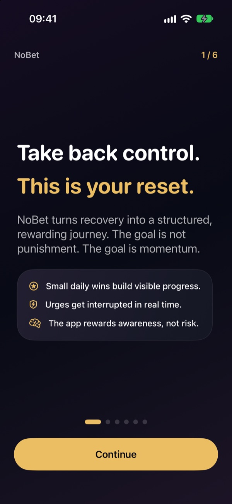<br><sub><b>Onboarding</b></sub></td>
    <td align="center">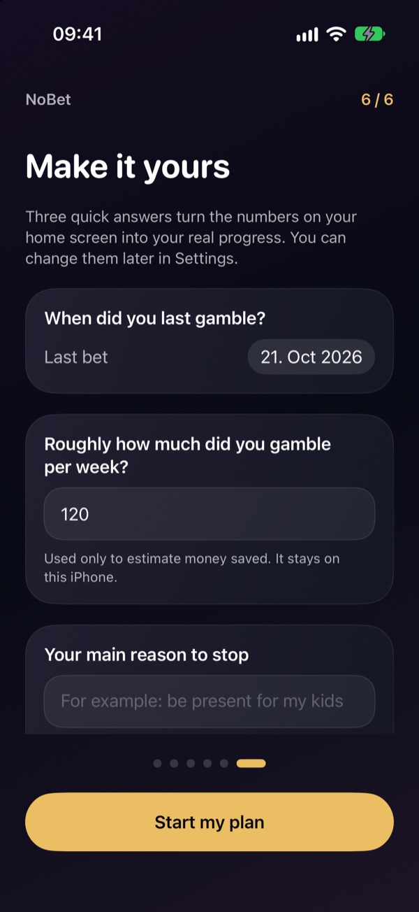<br><sub><b>Your plan</b></sub></td>
    <td align="center"><br><sub><b>Home</b></sub></td>
    <td align="center">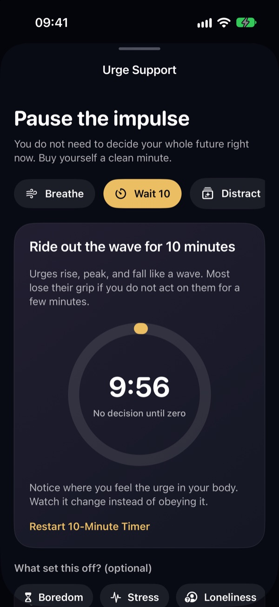<br><sub><b>Wait 10</b></sub></td>
  </tr>
  <tr>
    <td align="center">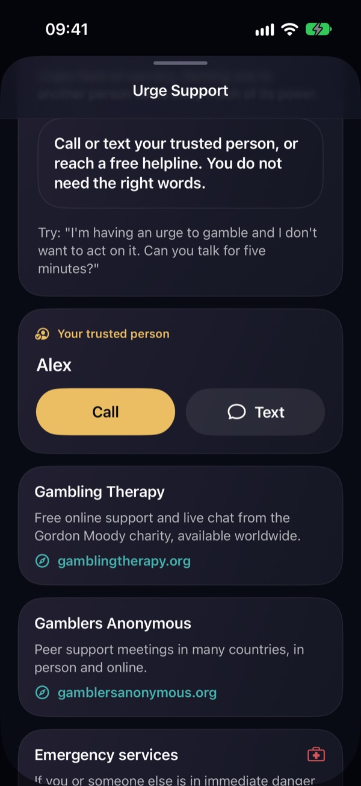<br><sub><b>Reach Out</b></sub></td>
    <td align="center"><br><sub><b>Protect</b></sub></td>
    <td align="center">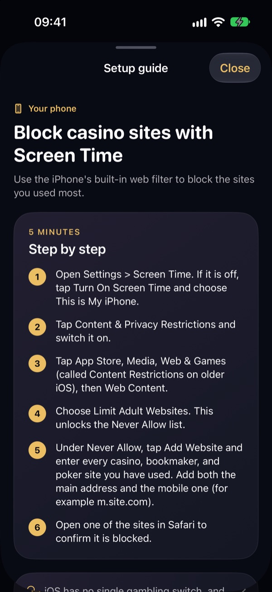<br><sub><b>Setup guide</b></sub></td>
    <td align="center">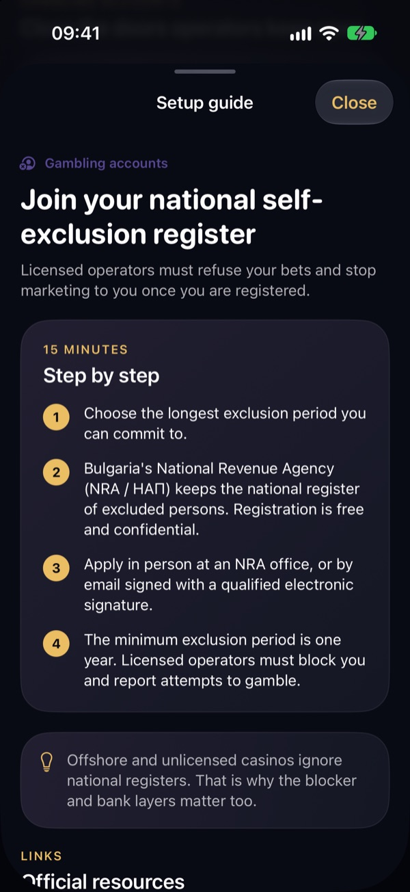<br><sub><b>Regional self-exclusion</b></sub></td>
  </tr>
  <tr>
    <td align="center">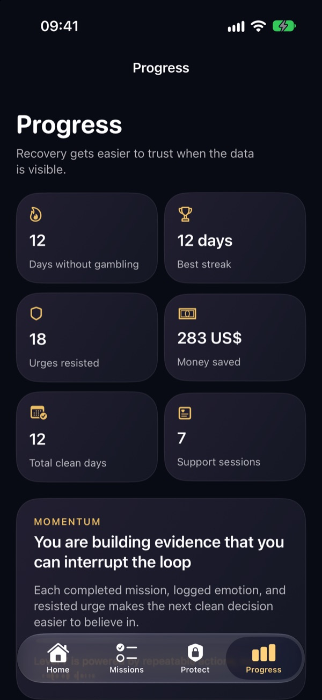<br><sub><b>Progress</b></sub></td>
    <td align="center">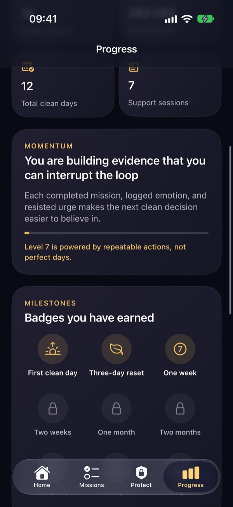<br><sub><b>Milestones</b></sub></td>
    <td align="center">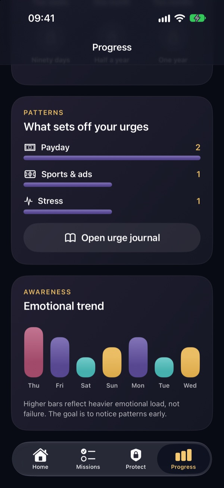<br><sub><b>Trigger patterns</b></sub></td>
    <td align="center">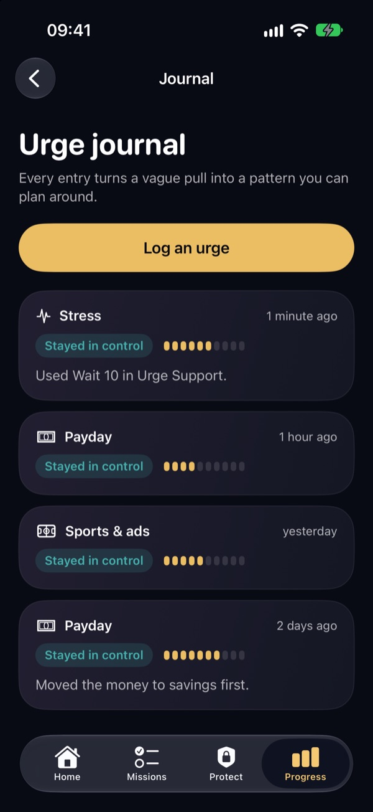<br><sub><b>Urge journal</b></sub></td>
  </tr>
  <tr>
    <td align="center">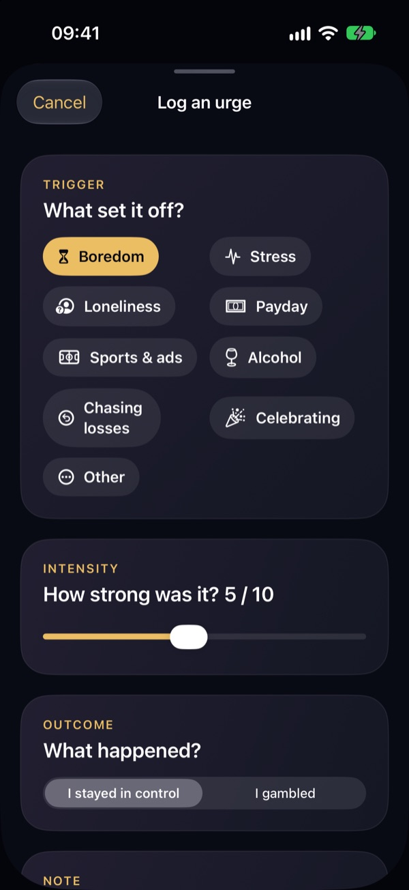<br><sub><b>Log an urge</b></sub></td>
    <td align="center">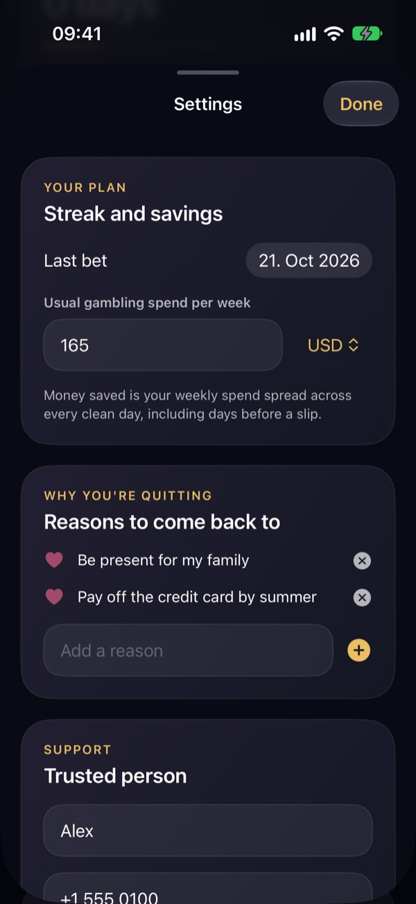<br><sub><b>Settings</b></sub></td>
    <td></td>
    <td></td>
  </tr>
</table>

<sub>Screenshots taken on an iPhone 17 simulator with the app's built-in demo data.</sub>

## Features

### Home
- **Real streak** counted from the date of your last bet, with the next milestone ("Two weeks in 2 days").
- **Money saved**, worked out from your usual weekly spend and shown in your own currency.
- **Levels and XP** for recovery actions, a focus mission, and a nudge toward your next protection layer.
- **Daily emotion check-in.** XP is awarded once per day, so it rewards awareness, not tapping.

### Urge support ("I feel like gambling")
| Tool | What it does |
| --- | --- |
| **Breathe** | 30-second guided 4-4-6 breathing ring |
| **Wait 10** | 10-minute countdown: no decision until it reaches zero |
| **Distract** | A quick task that breaks autopilot |
| **Ground** | 5-4-3-2-1 sensory grounding |
| **Reset Mindset** | A recovery reminder plus *your own* reasons for quitting |
| **Reach Out** | Call or text your trusted person, plus helplines for your region |

Before closing the sheet you can tag the trigger. **"I stayed in control"** records the win in your journal. **"I gambled. Log it honestly."** records a slip without wiping your history.

### Protect: online casino blockers
A nine-step checklist with step-by-step instructions and official links for each layer:

| Layer | Steps |
| --- | --- |
| Your phone | Screen Time web filter · Remove and lock out gambling apps · Dedicated blocker (BetBlocker / Gamban) |
| Your network | NextDNS gambling category on iPhone and home Wi-Fi |
| Your money | Bank gambling block (Revolut, Monzo, Starling and others) |
| Gambling accounts | National self-exclusion register · Close accounts and cut the marketing |
| Your people | Hand the Screen Time passcode to someone else · Choose your trusted person |

Self-exclusion steps and helplines change with your **region**: United States, United Kingdom, Bulgaria, other EU countries, or elsewhere. A shield ring tracks how many layers you have in place.

📖 The same guide is available as a document: **[docs/BLOCKER_SETUP_GUIDE.md](docs/BLOCKER_SETUP_GUIDE.md)**

### Missions
Five short daily missions (delay, trigger scan, habit swap, reflection, add a protection layer). They reset automatically each day.

### Progress and journal
- Days without gambling, best streak, total clean days, urges resisted, money saved, support sessions.
- **Milestone badges** at 1, 3, 7, 14, 30, 60, 90, 180 and 365 days.
- **Trigger patterns**: your most common triggers, ranked.
- **Urge journal** with trigger, intensity (1–10), outcome, and notes. Long-press an entry to delete it.
- Emotional trend for the last seven check-ins.

### Privacy
Everything is stored locally in `UserDefaults` on the device. There are no accounts, no analytics, and no network calls. The only links that leave the app are the official resources you choose to open.

## Tech stack

- **SwiftUI** with the Observation framework (`@Observable` store injected through the environment)
- **iOS 17+**, iPhone
- `UserNotifications` for the daily check-in reminder
- No third-party dependencies

## Project structure

```
ios-starter/NoBetStarter/
├── NoBetApp.swift              App entry, scene-phase refresh, demo-data flag
├── RecoveryStore.swift         @Observable store: streaks, slips, XP, journal, persistence
├── Models.swift                Missions, emotions, triggers, milestones, support tools
├── ProtectionGuide.swift       Blocker checklist content, regions, helplines
├── ReminderScheduler.swift     Daily check-in notification
├── DesignSystem.swift          Theme colours, cards, buttons, chips, progress ring
├── RootView.swift              Tab bar: Home · Missions · Protect · Progress
├── OnboardingFlowView.swift    Welcome, reality checks, methods, personal plan
├── HomeView.swift
├── UrgeSupportSheet.swift
├── MissionsView.swift
├── ProtectView.swift           Protect tab and step-by-step guide sheet
├── ProgressDashboardView.swift
├── UrgeJournalView.swift       Journal list and "Log an urge" sheet
├── SupportContactsView.swift   Trusted person and helplines
├── SettingsView.swift
└── Assets.xcassets             App icon
docs/
├── BLOCKER_SETUP_GUIDE.md
└── screenshots/
tools/
└── make_icon.swift             Regenerates the app icon
```

## Roadmap

- [ ] Enforce blocks in the app with Apple's **Screen Time API** (FamilyControls / ManagedSettings), once the Family Controls distribution entitlement is approved.
- [ ] Move persistence to **SwiftData**, with optional iCloud sync.
- [ ] Home Screen and Lock Screen **widgets** for the streak and urge button.
- [ ] Localisation, starting with Bulgarian.
- [ ] Clinician review of the reality-check and mission content.
- [ ] Accessibility pass: Dynamic Type, VoiceOver, and contrast.

## Get help now

NoBet is a self-help tool, not a treatment or a crisis service. If gambling is hurting you or someone close to you, free and confidential help is available:

- 🇺🇸 **National Problem Gambling Helpline:** call or text **1-800-MY-RESET** (1-800-697-3738)
- 🇬🇧 **National Gambling Helpline (GamCare):** **0808 8020 133**, free and 24/7
- 🌍 **Gambling Therapy:** free online support and live chat, [gamblingtherapy.org](https://www.gamblingtherapy.org)
- 🌍 **Gamblers Anonymous:** [gamblersanonymous.org](https://www.gamblersanonymous.org)

If you feel unsafe, call **988** (US), **Samaritans 116 123** (UK), or your local emergency number (**112** in the EU).

## License

© 2026 Christo Dontchev. All rights reserved. The source code is private and is not licensed for
use, copying or distribution; see [LICENSE](LICENSE).
